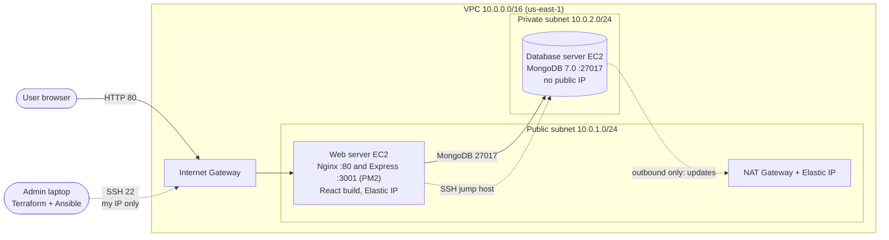
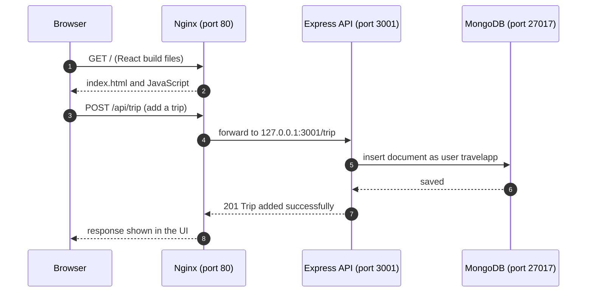

# mern-terraform-ansible-assignment

<div align="center">

# Deploying a MERN Application on AWS with Terraform and Ansible

**Infrastructure as Code for the [TravelMemory](https://github.com/UnpredictablePrashant/TravelMemory) app: network, servers, security and deployment, all from code.**


*Hero Vired DevOps Program: assignment "Deploying a MERN Application through Terraform and Ansible"*

</div>

---

## Table of contents

1. [Overview](#1-overview)
2. [Architecture](#2-architecture)
3. [Repository structure](#3-repository-structure)
4. [Prerequisites](#4-prerequisites)
5. [Quick start](#5-quick-start)
6. [Part 1: Terraform in detail](#6-part-1-terraform-in-detail)
7. [Part 2: Ansible in detail](#7-part-2-ansible-in-detail)
8. [Security](#8-security)
9. [Verification and evidence](#9-verification-and-evidence)
10. [Problems faced and how they were solved](#10-problems-faced-and-how-they-were-solved)
11. [Cost and clean-up](#11-cost-and-clean-up)
12. [Future improvements](#12-future-improvements)
13. [Credits](#13-credits)

---

## 1. Overview

This project deploys the **TravelMemory** MERN application (MongoDB, Express, React, Node.js) on AWS **without any manual console work**.

| Tool | Responsibility |
|---|---|
| **Terraform** | Builds the cloud infrastructure: VPC, public and private subnets, Internet Gateway, NAT Gateway, route tables, security groups, IAM role, two EC2 instances and an Elastic IP |
| **Ansible** | Configures the servers and deploys the app: Node.js, Nginx, PM2, MongoDB with authentication, environment files, React build, firewall and SSH hardening |

If the environment is destroyed and the commands are run again, the same result is produced. That repeatability is the point of Infrastructure as Code.

**Key results**

- 20 AWS resources created by one `terraform apply`
- Web server in a public subnet; database server in a **private subnet with no public IP**
- MongoDB reachable only from the web server, with authentication enabled
- Secrets kept out of Git with **Ansible Vault** and `.gitignore`
- Playbooks are **idempotent**: a second run changes almost nothing

---

## 2. Architecture



### Request flow



1. The browser opens `http://<web-public-ip>/`. Traffic enters through the **Internet Gateway** and the web server's **security group** (port 80).
2. **Nginx** serves the React build. React runs in the user's browser.
3. API calls go to `/api/...` on the same address. Nginx removes `/api` and forwards the request to **Express** on `127.0.0.1:3001`, so port 3001 is never exposed to the internet.
4. Express connects to **MongoDB** on the database server's private IP, port 27017, as the least-privilege user `travelapp`.
5. The database server has no public IP. It downloads packages through the **NAT Gateway** (outbound only).

---

## 3. Repository structure

```text
.
├── README.md
├── .gitignore
├── terraform/
│   ├── providers.tf          # AWS provider, region, default tags
│   ├── variables.tf          # region, CIDR ranges, my IP, key path, instance types
│   ├── main.tf               # VPC, subnets, gateways, routes, SGs, IAM, EC2, EIPs
│   ├── outputs.tf            # web public IP, DB private IP, SSH commands
│   └── .terraform.lock.hcl   # provider version lock
├── ansible/
│   ├── ansible.cfg
│   ├── inventory/
│   │   ├── hosts.ini             # created by you, git-ignored
│   │   └── group_vars/all/
│   │       ├── vars.yml          # shared settings
│   │       └── vault.yml         # encrypted secrets, created by you, git-ignored
│   └── playbooks/
│       ├── 01-common.yml        # base packages on all servers
│       ├── 02-database.yml      # MongoDB install, users, authentication
│       ├── 03-webserver.yml     # Node.js, Nginx, PM2, clone, .env, build, deploy
│       ├── 04-hardening.yml     # SSH, UFW, fail2ban, automatic updates
│       └── site.yml             # runs 01 to 04 in order
└── docs/
    └── ...                      # implementation report and screenshots
```

> Files that hold secrets or local values are **not** in the repository: `terraform.tfvars`, `terraform.tfstate`, `inventory/hosts.ini`, `inventory/group_vars/all/vault.yml`, `.vault_pass` and SSH keys. You create them yourself in the quick start below.

---

## 4. Prerequisites

| Requirement | Notes |
|---|---|
| AWS account | An IAM user with programmatic access (the lab used `AdministratorAccess`) |
| AWS CLI v2 | `aws configure` with that user's key and region `us-east-1` |
| Terraform 1.5 or newer | `terraform -version` |
| Ansible | `ansible --version` (the full `ansible` package includes `community.general`) |
| SSH key pair | `ssh-keygen -t ed25519 -f ~/.ssh/mern-key` and `chmod 600 ~/.ssh/mern-key` |
| Your public IP | `curl -s https://checkip.amazonaws.com` (used as `x.x.x.x/32`) |

macOS (Homebrew): `brew install awscli ansible` and `brew tap hashicorp/tap && brew install hashicorp/tap/terraform`

---

## 5. Quick start

> Run every command from the repository root. Replace placeholders such as `<your-ip>`.

### Step 1: Authenticate to AWS

```bash
aws configure                      # key id, secret, region us-east-1, output json
aws sts get-caller-identity        # must print your account and user ARN
```

### Step 2: Create the infrastructure with Terraform

Create `terraform/terraform.tfvars` with your own values (the file is git-ignored):

```hcl
aws_region      = "us-east-1"
my_ip_cidr      = "<your-ip>/32"     # only this IP may SSH to the web server
public_key_path = "~/.ssh/mern-key.pub"
```

Then:

```bash
cd terraform
terraform init
terraform validate
terraform plan -out=tfplan           # expect: Plan: 20 to add, 0 to change, 0 to destroy
terraform apply tfplan
terraform output                     # web_public_ip, db_private_ip, ssh commands
```

### Step 3: Create the Ansible inventory from Terraform's outputs

```bash
WEB=$(terraform output -raw web_public_ip)
DB=$(terraform output -raw db_private_ip)

cat > ../ansible/inventory/hosts.ini <<EOF
[web]
web1 ansible_host=$WEB

[db]
db1 ansible_host=$DB ansible_ssh_common_args='-o ProxyCommand="ssh -W %h:%p -q -i ~/.ssh/mern-key -o StrictHostKeyChecking=accept-new ubuntu@$WEB" -o StrictHostKeyChecking=accept-new'

[all:vars]
ansible_user=ubuntu
ansible_ssh_private_key_file=~/.ssh/mern-key
EOF
```

The database server has no public IP, so Ansible reaches it through the web server (jump host).

### Step 4: Create the encrypted secrets file

```bash
cd ../ansible
openssl rand -hex 12                 # run twice: two database passwords
EDITOR=nano ansible-vault create inventory/group_vars/all/vault.yml
```

You choose a vault password at the prompt. Inside the editor enter:

```yaml
---
vault_mongo_admin_password: "<first generated password>"
vault_mongo_app_password: "<second generated password>"
```

Save the vault password in a git-ignored file so Ansible stops asking for it:

```bash
printf '%s' '<your vault password>' > .vault_pass
chmod 600 .vault_pass
nano ansible.cfg                     # un-comment: vault_password_file = .vault_pass (no leading space)
```

### Step 5: Check connectivity and deploy

```bash
ansible all -m ping                  # web1 and db1 must both answer: pong
ansible-playbook playbooks/site.yml  # about 10 to 20 minutes (the React build is slow)
```

End of the run: `failed=0` and `unreachable=0` for both servers.

### Step 6: Open the application

```text
http://<web_public_ip>/
```

Add a trip in the UI, then refresh the page: the trip stays, which proves React, Express and MongoDB work together.

---

## 6. Part 1: Terraform in detail

| Assignment task | Where it is implemented |
|---|---|
| 1. AWS setup and initialisation | AWS CLI configured; `providers.tf` pins the AWS provider and applies `default_tags` |
| 2. VPC and network | `main.tf`: VPC, public and private subnets, Internet Gateway, NAT Gateway with Elastic IP, public route table (to IGW), private route table (to NAT) |
| 3. EC2 provisioning | Web server `t3.small` in the public subnet (Elastic IP); database `t3.micro` in the private subnet (no public IP); Ubuntu 22.04 AMI looked up automatically; same SSH key pair on both |
| 4. Security groups and IAM | `web-sg` and `db-sg`; IAM role and instance profile with SSM and CloudWatch policies |
| 5. Resource output | `outputs.tf`: `web_public_ip`, `db_private_ip`, `vpc_id`, SSH commands |

<details>
<summary><b>Terraform variables</b></summary>

| Variable | Default | Purpose |
|---|---|---|
| `aws_region` | `us-east-1` | Deployment region |
| `project_name` | `mern-travelmemory` | Name prefix and tags |
| `vpc_cidr` | `10.0.0.0/16` | VPC range |
| `public_subnet_cidr` | `10.0.1.0/24` | Web server and NAT Gateway |
| `private_subnet_cidr` | `10.0.2.0/24` | Database server |
| `my_ip_cidr` | none (required) | Only this CIDR may SSH to the web server; `0.0.0.0/0` is rejected by a validation rule |
| `public_key_path` | `~/.ssh/mern-key.pub` | Public key installed on both servers |
| `web_instance_type` | `t3.small` | 2 GB RAM so the React build does not run out of memory |
| `db_instance_type` | `t3.micro` | MongoDB server |

</details>

<details>
<summary><b>Resources created (20)</b></summary>

VPC, Internet Gateway, 2 subnets, NAT Elastic IP, NAT Gateway, 2 route tables, 2 route table associations, 2 security groups, IAM role, 2 policy attachments, instance profile, key pair, 2 EC2 instances, web Elastic IP.

</details>

---

## 7. Part 2: Ansible in detail

| Assignment task | Where it is implemented |
|---|---|
| 1. Ansible configuration | `ansible.cfg`, `inventory/hosts.ini` with jump host, `group_vars/all/vars.yml`, Ansible Vault |
| 2. Web server setup | `03-webserver.yml`: Node.js 22 (NodeSource) with NPM, Nginx, PM2, clone TravelMemory into `/opt/travelmemory`, `npm install` for backend and frontend |
| 3. Database server setup | `02-database.yml`: MongoDB 7.0 repository and install, admin and application users, `authorization: enabled`, bind to private IP |
| 4. Application deployment | `03-webserver.yml`: `backend/.env`, `frontend/.env`, React build, backend under PM2, Nginx `/api` proxy |
| 5. Security hardening | `04-hardening.yml`: SSH key-only login, root login disabled, UFW, fail2ban, automatic security updates (plus security groups from Terraform) |

### Environment variables written by the playbook

| File | Content | Why |
|---|---|---|
| `backend/.env` | `MONGO_URI=mongodb://travelapp:***@<db-private-ip>:27017/travelmemory?authSource=travelmemory`<br>`PORT=3001`<br>`CORS_ORIGIN=http://<web-public-ip>` | Database connection, backend port, and the website address the backend accepts requests from |
| `frontend/.env` | `REACT_APP_BACKEND_URL=http://<web-public-ip>/api` | Read at **build time**; sends API calls through the Nginx `/api` path |

### Nginx site (written by playbook 03)

- Serves the React build from `/opt/travelmemory/frontend/build`
- `location /api/` proxies to `http://127.0.0.1:3001/`
- `client_max_body_size 10m;` so image uploads from the add-trip form are accepted (Nginx defaults to 1 MB)
- The default Nginx site is removed to avoid a port 80 conflict

### MongoDB users

| User | Role | Used by |
|---|---|---|
| `mongoadmin` | `root` on `admin` | Administration only |
| `travelapp` | `readWrite` on `travelmemory` only | The Express backend (least privilege) |

### Run one playbook at a time

```bash
ansible-playbook playbooks/01-common.yml
ansible-playbook playbooks/02-database.yml
ansible-playbook playbooks/03-webserver.yml
ansible-playbook playbooks/04-hardening.yml      # keep a second SSH window open
```

---

## 8. Security

### Open ports

| Port | Service | Web server | Database server |
|---|---|---|---|
| 22 | SSH | My IP only (security group), rate-limited by UFW | Web security group only; `10.0.1.0/24` in UFW |
| 80 | HTTP (Nginx) | Open to the internet | Closed |
| 443 | HTTPS | Open in SG and UFW, no certificate installed yet | Closed |
| 3001 | Express backend | **Not open**, reached only through Nginx | Closed |
| 27017 | MongoDB | Closed | Web security group only; `10.0.1.0/24` in UFW |

### Login methods

| What | How | Protection |
|---|---|---|
| Web server (SSH) | SSH key pair, user `ubuntu` | No password login, root login disabled, `AllowUsers ubuntu`, fail2ban, only my IP in the security group |
| Database server (SSH) | SSH key through the web server (jump host) | No public IP; security group accepts only the web security group |
| MongoDB | `travelapp` (application), `mongoadmin` (admin) | Authentication enabled; passwords in Ansible Vault |
| AWS console shell (backup) | Session Manager | IAM instance profile, no open port needed |

### Additional measures

- Two firewall layers: AWS security groups and UFW on each server
- IMDSv2 required and encrypted EBS volumes on both instances
- Automatic security updates and fail2ban against repeated SSH attempts
- No AWS access keys stored on the servers; permissions come from the IAM instance profile
- Terraform validation rejects `my_ip_cidr = "0.0.0.0/0"`
- `.gitignore` keeps state files, `terraform.tfvars`, `hosts.ini`, `.vault_pass`, `vault.yml` and SSH keys out of Git

---

## 9. Verification and evidence

Screenshots and the full implementation report are in the [`docs/`](docs/) folder.

<details>
<summary><b>Checks to run after deployment</b></summary>

**On the web server** (`ssh -i ~/.ssh/mern-key ubuntu@<web-ip>`)

```bash
pm2 status                          # travel-backend: online
sudo nginx -t                       # syntax is ok
curl -I http://localhost            # HTTP 200
sudo ufw status verbose
sudo sshd -T | grep -Ei 'permitrootlogin|passwordauthentication|allowusers'
```

**On the database server** (SSH through the web server)

```bash
ssh -i ~/.ssh/mern-key -o ProxyCommand="ssh -W %h:%p -i ~/.ssh/mern-key ubuntu@<web-ip>" ubuntu@<db-private-ip>

sudo systemctl status mongod --no-pager
sudo ss -tlnp | grep 27017          # 127.0.0.1 and 10.0.2.x only
mongosh --quiet --eval "db.adminCommand('listDatabases')"       # must FAIL: requires authentication
mongosh -u travelapp --authenticationDatabase travelmemory travelmemory
#   > show collections
#   > db.tripdetails.find().limit(1)
```

**Negative tests from the laptop**

```bash
nc -zv <web-ip> 27017               # must fail
nc -zv <web-ip> 3001                # must fail
nc -zv <web-ip> 80                  # must succeed
ssh root@<web-ip>                   # must be denied
```

**API test**

```bash
curl -s http://<web-ip>/api/trip    # JSON list of trips
```

The API expects dates as `YYYY-MM-DD`.

</details>

---

## 10. Problems faced and how they were solved

<details>
<summary><b>Show the issues and fixes</b></summary>

| # | Problem | Cause | Fix |
|---|---|---|---|
| 1 | Terraform: `InvalidClientTokenId` while the AWS CLI worked | Region was set to `ap-east-1` (Hong Kong), an opt-in region that is disabled by default; stale credentials as well | Set `aws_region = "us-east-1"`, created a new IAM access key, re-ran `aws configure` |
| 2 | EC2 instances not visible in the console | Console showed a different region from the one Terraform used | Matched the console region and searched for `mern-travelmemory-vpc` |
| 3 | Ansible: `mongo_version is undefined` | `group_vars` was outside the inventory folder, so it was not loaded for playbooks in `playbooks/` | Moved it to `ansible/inventory/group_vars/` |
| 4 | Ansible: `Attempting to decrypt but no vault secrets found` | `vault_password_file` was commented out, then indented by a space | Created `.vault_pass` and removed the leading space in `ansible.cfg` |
| 5 | Re-running playbook 03: `Local modifications exist in the destination` | `npm install` modified a tracked file | Added `force: true` to the git task |
| 6 | Browser: `CORS: origin http://<ip> is not allowed` | Backend only accepts origins listed in `CORS_ORIGIN` (default `http://localhost:3000`) | Added `CORS_ORIGIN=http://<web-ip>` to `backend/.env` in the playbook |
| 7 | Saving a trip in the UI failed with `413` (curl worked) | The form uploads an image; Nginx allows only 1 MB by default | Added `client_max_body_size 10m;` to the Nginx server block |
| 8 | `git push` rejected, and the encrypted vault file was tracked | Remote already had a commit; `.gitignore` still had the old `group_vars` path | Merged remote history, fixed `.gitignore`, removed `vault.yml` from history before pushing |

</details>

---

## 11. Cost and clean-up

The NAT Gateway, the two EC2 instances and the public IPv4 addresses are billed **by the hour**. Rough planning figure while running: about US$2 to 3 per day (check the AWS pricing page for your region).

Destroy everything when the evidence is collected and the code is pushed:

```bash
cd terraform
terraform destroy                   # type yes; removes all 20 resources
```

Then check the console in `us-east-1`: no running instances, no NAT Gateways, no Elastic IPs left, and only the default VPC remaining.

---

## 12. Future improvements

- HTTPS with a domain name and a Let's Encrypt certificate on Nginx
- Remote Terraform state in S3 with DynamoDB locking
- Separate backend and frontend servers, or containers with Docker
- Application Load Balancer with Auto Scaling for the web tier
- MongoDB replica set or a managed database service
- CI/CD (GitHub Actions or Jenkins) to run `terraform plan` and the playbooks automatically
- Monitoring and alerting with CloudWatch, Prometheus and Grafana

---

## 13. Credits

- Application: [TravelMemory](https://github.com/UnpredictablePrashant/TravelMemory) by UnpredictablePrashant
- Built as part of the Hero Vired DevOps Program by [dhanacodes24](https://github.com/dhanacodes24)
